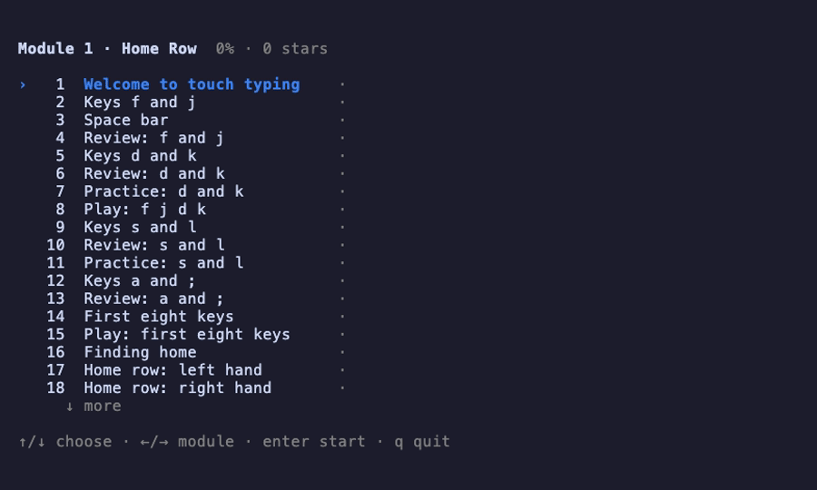
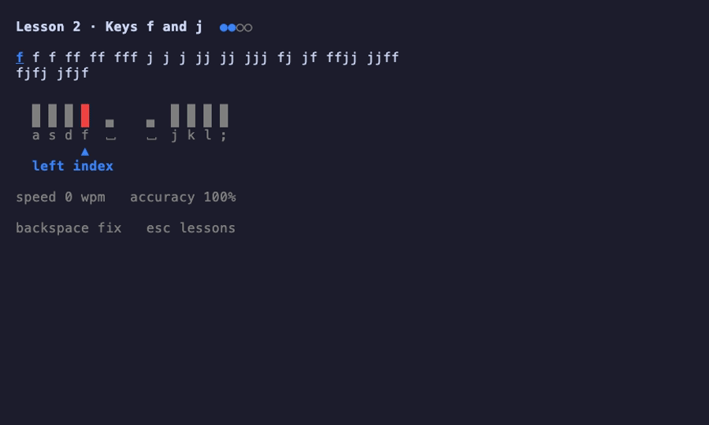
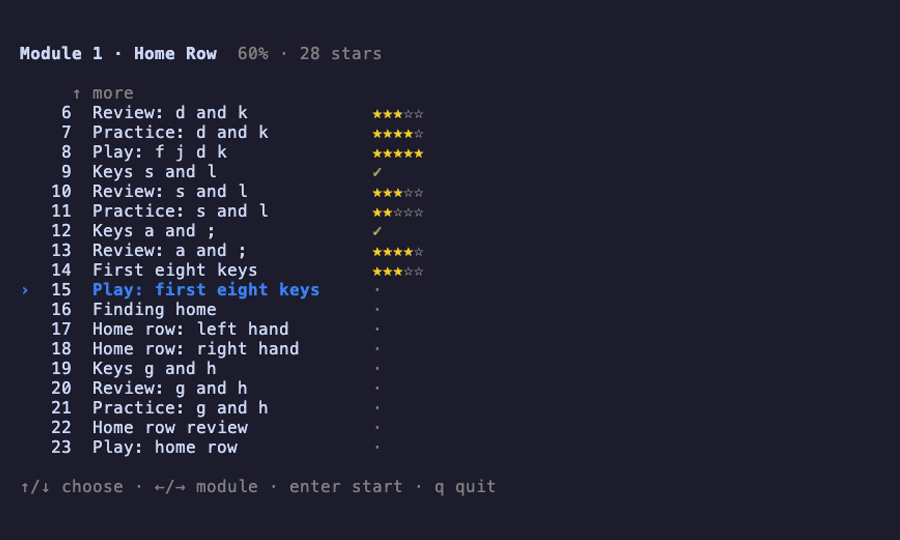

# homerow

Learn touch typing in your terminal, one row at a time.

`homerow` walks you through a structured course: new keys are introduced one
pair at a time, you drill them, review them, race the clock with them, and play
a short game before moving on. Every exercise is scored on accuracy and speed
and earns up to five stars.

The course has 218 lessons in seven modules. `homerow lessons` lists every
lesson with your stars, grouped by module.

| Module      | Lessons | Keys                                  |
| ----------- | ------- | ------------------------------------- |
| Home Row    | 1–23    | `a s d f g h j k l ;` and space       |
| Top Row     | 24–51   | `q w e r t y u i o p`                 |
| Bottom Row  | 52–88   | `z x c v b n m , . /` and tab         |
| Shift Key   | 89–142  | every capital, `:` and `?`            |
| Numbers     | 143–157 | `1` to `0`                            |
| Symbols     | 158–187 | `! @ # $ % ^ & * ( )`                 |
| Punctuation | 188–218 | `` - ' [ ] = \ _ + { } " \| < > ` ~ `` |



Each new key comes with the finger that types it.



Mistakes turn red; backspace fixes them in yellow.



Earn stars, then catch falling letters.

## Install

With Homebrew on macOS or Linux:

```sh
brew install helmedeiros/tap/homerow
```

With Go:

```sh
go install github.com/helmedeiros/homerow/cmd/homerow@latest
```

or from a clone:

```sh
make build && ./bin/homerow
```

## Usage

```sh
homerow                  # open the tutor
homerow lessons          # list the lessons and your progress
homerow reset            # erase your progress (asks first)
homerow version
homerow --data FILE ...  # use another progress file
```

| Where          | Keys                                                     |
| -------------- | -------------------------------------------------------- |
| Lesson list    | `↑` `↓` or `k` `j` to move, `←` `→` to switch module, `enter` to start, `q` to quit |
| Intro pages    | `enter`, `space` or `→` for the next page                |
| Typing        | just type; `backspace` fixes a mistake, `esc` returns to the lesson list |
| Games         | just type; `esc` returns to the lesson list              |
| Results        | `enter` next lesson (or retry after a fail), `r` retry, `esc` list |

`ctrl+c` quits from anywhere.

## Lessons

| Type      | What happens                                                        |
| --------- | ------------------------------------------------------------------- |
| Intro     | a few pages on posture, breaks, the keyboard and the keys to come   |
| New keys  | each new key with the finger that types it, then a warm-up drill    |
| Review    | a drill that mixes the new keys with the ones you already know      |
| Practice  | a one-minute timed drill, with real words once there are enough keys |
| Hand drill| keys for one hand only                                              |
| Travel    | reach from a home key to its neighbours and back, e.g. `juj jmj jhj` |
| Tab       | pairs of words split by a tab, shown as `→`                         |
| Dynamic   | a drill weighted towards the keys you miss most                     |
| Play      | a short game over the keys you know                                 |

Capitals come with the shift key of the other hand, and the hands show both
fingers. Numbers are mixed with words, and symbols sit where they are usually
typed: `$47`, `40%`, `@name`, `wow!`.

### Games

| Game            | How it plays                                                   |
| --------------- | -------------------------------------------------------------- |
| Falling letters | catch letters before they land; three lives, one minute        |
| Balloons        | type whole words before they float away; three lives, one minute |
| Pop-up          | catch keys before they hide again; an unscored warm-up         |

While you type, correct characters turn green and mistakes red. Press
backspace to fix a mistake: it turns yellow once retyped, and still counts
against accuracy. The keyboard and hands show which finger comes next, and
speed (wpm) and accuracy update live.

### Stars

Accuracy earns up to four stars: 80% for one, 88% for two, 94% for three and
97% for four. The fifth star needs four stars and the lesson's speed goal. A
lesson passes with at least one star; intro and new-key lessons pass by
finishing them. Your best result for each lesson is kept.

## Progress

Progress, including how often you miss each key, is saved as JSON in the
first of:

1. the `--data FILE` flag
2. the `HOMEROW_DATA` environment variable
3. `homerow/progress.json` in your user config folder
   (`~/Library/Application Support` on macOS, `~/.config` on Linux,
   `%AppData%` on Windows)

## Development

```sh
make check   # gofmt, go vet, golangci-lint, go test -race, coverage floor
make build   # ./bin/homerow
```

The design is hexagonal: see
[docs/adr/0001-hexagonal-architecture.md](docs/adr/0001-hexagonal-architecture.md).
How lessons and games fit in is in
[docs/adr/0002-lesson-kinds-and-games.md](docs/adr/0002-lesson-kinds-and-games.md).
